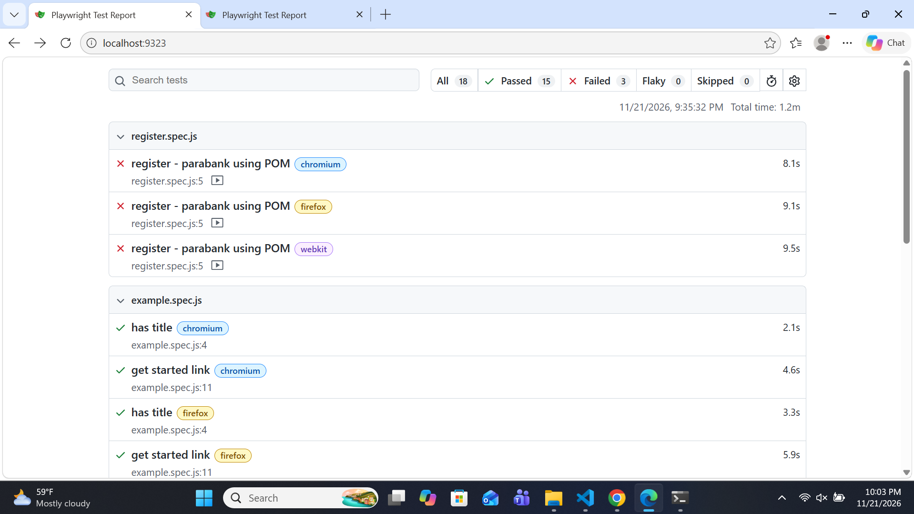

# Playwright Automation – SauceDemo & ParaBank

## Tech
Playwright, JavaScript, Page Object Model, custom fixtures

## Structure
- pages/ – page objects (LoginPage, InventoryPage, RegistrationPage)
- fixtures/ – custom fixtures
- tests/ – test specs
- playwright.config.js – 3 browsers, screenshots, video, trace

## Run
npm install
npx playwright install
npx playwright test
npx playwright show-report

## Report
