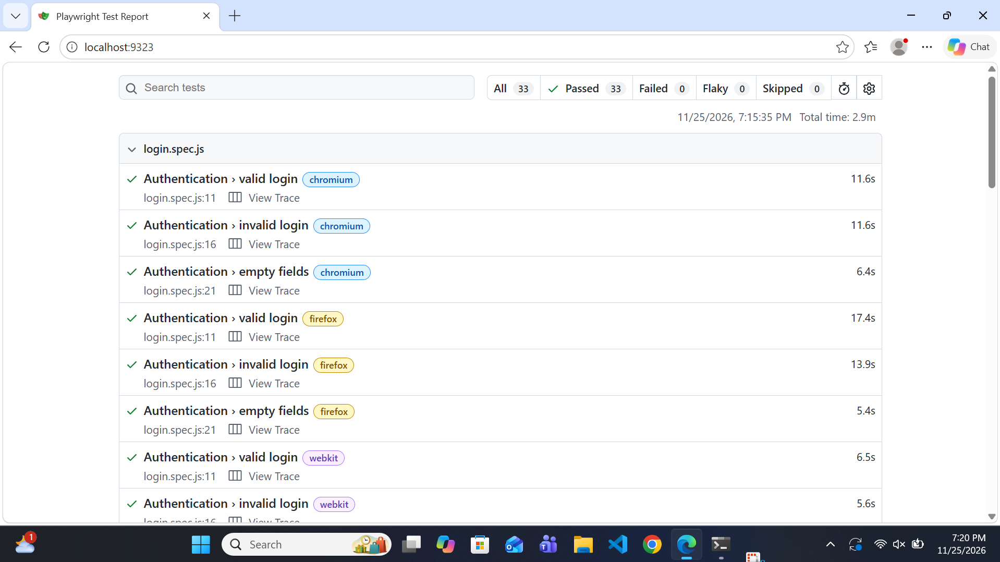

# SQA Automation Project

End-to-end tests for practicesoftwaretesting.com using Playwright (JavaScript),
Page Object Model and custom fixtures.

## Coverage
- Authentication: valid login, invalid login, empty fields, logout
- Registration
- Product search, add to cart, remove from cart
- Update profile

## Structure
- `pages/` page objects
- `fixtures/` custom fixtures
- `tests/` test specs

## Run
```bash
npm install
npx playwright install
npx playwright test
npx playwright show-report
```

## Report
